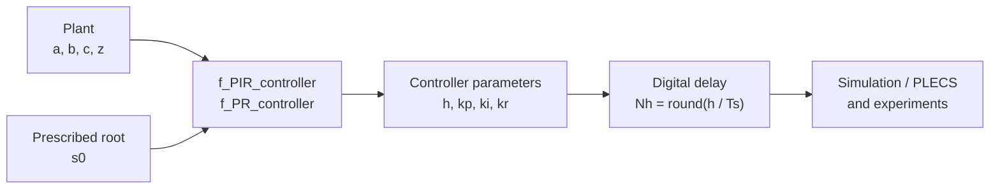

<div align="center">


<br/>

[](https://ieeeaccess.ieee.org/)
[](https://www.mathworks.com/)
[](https://gitlab.kuleuven.be/u0011378/tds-control)

**Erick Moreno-Negrete · Islam Boussaada · Silviu-Iulian Niculescu · César-Fernando Méndez-Barrios**

*Closed-form MATLAB functions and experimental scripts for PIR and PR controllers*

[Quick start](#-quick-start) ·
[Experiments](#-experimental-validation) ·
[Repository map](#-repository-map) ·
[Citation](#-citation) ·
[Contact](#-contact)

</div>

---

## ✨ Overview

Non-minimum phase (NMP) systems, such as the boost converter operating in continuous conduction, have a right-half-plane (RHP) zero that limits how fast the output can be regulated. This repository accompanies the paper

> **Analytical Tuning of PIR Controllers for Second-Order Non-Minimum Phase Systems**
> E. Moreno-Negrete, I. Boussaada, S.-I. Niculescu and C.-F. Méndez-Barrios
> *IEEE Access* (to be published)

The algebraic expressions that define the controller parameters are too long to print in the manuscript, so they are provided here as ready-to-run **MATLAB functions**, together with the scripts used to generate the experimental results and figures.

<table>
<tr>
<td width="50%" valign="top">

### 🎯 What you get

- Closed-form tuning of the **PIR** (proportional–integral–retarded) controller
- Closed-form tuning of the **PR** (proportional–retarded) controller
- Prescribed **quadruple dominant root** `s0` placement
- Reproducible experimental post-processing and figures

</td>
<td width="50%" valign="top">

### 🔧 Plant class

Second-order NMP systems in canonical form

```
        c (1 − z s)
G(s) = ─────────────
        s² + a s + b
```

described by the four numbers `a`, `b`, `c` and `z`.

</td>
</tr>
</table>

---

## 🧭 How it works



---

## 📋 Requirements

| Requirement | Notes |
|---|---|
| **MATLAB R2020a or newer** | Needed for `exportgraphics` and `readmatrix` |
| **Control System Toolbox** | `ss`, `tf`, `pade`, `step` in the experimental scripts |
| **[TDS-Control](https://gitlab.kuleuven.be/u0011378/tds-control)** | Required to run the examples |
| *Optimization Toolbox* | Optional. Without it the tuning falls back to `fminsearch` |

---

## 🚀 Quick start

**1. Clone the repository**

```bash
git clone https://github.com/erickmone/PIR_controllers.git
cd PIR_controllers
```

**2. Tune a PIR controller**

```matlab
[h, kp, ki, kr] = f_PIR_controller(s0, a, b, c, z);
```

**3. Tune a PR controller**

```matlab
[h, kp, kr] = f_PR_controller(s0, a, b, c, z);
```

| Symbol | Meaning |
|:---:|---|
| `s0` | Prescribed quadruple dominant root `[1/s]` |
| `a`, `b`, `c`, `z` | Canonical plant parameters |
| `h` | Intentional delay `[s]` |
| `kp`, `ki`, `kr` | Proportional, integral and retarded gains |

### 💡 Worked example: nonideal boost converter

For the converter of Experimental Case II (`Vin = 12 V`, `Vo = 42 V`, `L = 15 µH`, `C = 40 µF`, `R = 50 Ω`, `Fsw = 500 kHz`), the canonical parameters are

```matlab
a = 2597.885452946;        % s^-1
b = 1.30607389480386e8;    % s^-2
c = 1.96409789785864e10;
z = 3.83478228950127e-6;   % s   (RHP zero at 2.6077e5 rad/s)
s0 = -20000;               % s^-1
```

and the call `[h, kp, ki, kr] = f_PIR_controller(s0, a, b, c, z)` returns

| Parameter | Value |
|:---:|:---:|
| `h` | 33.2717 µs |
| `kp` | 0.038011 |
| `ki` | 79.1966 |
| `kr` | 0.029139 |

With a 10 µs controller period, the delay is implemented as `Nh = 3` samples (`hd = 30 µs`).

---

## 🔬 Experimental validation

Two experimental cases are included, each in its own folder with its script and data.

### Case I: Output-voltage regulation

Two scripts, one per controller family. Both read the CSV files stored in the same folder.

| Script | What it does |
|---|---|
| `ExperimentalCaseI_PIR.m` | Modified PIR (`s0 = -1250, -1500, -2000`) against a filtered PID (`s0 = -1000`): time-aligned output voltage, duty-cycle comparison and performance tables |
| `ExperimentalCaseI_PR.m` | PR controller (`s0 = -2000, -2050, -2100`): output-voltage response and performance table |

```text
ExperimentalCaseI/
├── ExperimentalCaseI_PIR.m
├── ExperimentalCaseI_PR.m
├── ExperimentalCaseI_Control_All.csv
├── ExperimentalCaseI_Voltage_PIRm1250.csv
├── ExperimentalCaseI_Voltage_PIRm1500.csv
├── ExperimentalCaseI_Voltage_PIRm2000.csv
├── ExperimentalCaseI_Voltage_fPID1000.csv
├── PR2000_seconds.csv
├── PR2050_seconds.csv
└── PR2100_seconds.csv
```

**`ExperimentalCaseI_PIR.m`** produces

- the time-aligned output-voltage responses → `ExperimentalCaseI_OutputVoltage.pdf`
- the duty-cycle comparison → `ExperimentalCaseI_DutyCycle.pdf`
- tables with rise time, settling time, overshoot, undershoot, steady-state error, ripple, IAE and duty-cycle effort metrics

**`ExperimentalCaseI_PR.m`** produces

- the output-voltage figure of the three PR designs (PDF)
- a table with `t_r`, `t_s`, `M_p`, `M_u`, `e_ss`, `v_min`, `v_max`, `Δv_pp` and IAE

> [!NOTE]
> The `PR*_seconds.csv` files contain the output-voltage waveforms extracted from the experimental records, with time converted to seconds (columns `Time_s`, `Voltage_V`). For the PR metrics, `t_r`, `t_s`, `M_p`, `e_ss` and IAE are computed from a 20 ms moving average of the waveform, whereas `v_min`, `v_max` and `Δv_pp` come from the unfiltered waveform.

### Case II: Nonideal model versus PLECS

Nonideal operating point, duty-to-output model, PIR tuning with quantized digital delay, and comparison against the PLECS switching model.

```text
ExperimentalCaseII/
├── ExperimentalCaseII.m
└── PLECS_Voltage.csv
```

Run `ExperimentalCaseII.m` to obtain:

- the operating point, canonical parameters and controller gains in the Command Window
- the performance table (model vs PLECS), including RMSE, MAE and NRMSE
- the comparison figure → `PLECS_comparison.pdf`

> [!NOTE]
> The Case II time-domain metrics (rise time, settling time, overshoot, steady-state error and IAE) are computed from the **PLECS switching-model simulation**, averaged over one switching period. They are not extracted from the oscilloscope capture.

### Metric definitions

| Metric | Definition |
|:---:|---|
| `t_r` | 10 %–90 % rise time |
| `t_s` | Time after which the response stays within a 2 % band of the reference |
| `M_p`, `M_u` | Maximum overshoot and undershoot, in percent |
| `e_ss` | Steady-state error from the median/mean of the final window |
| `Δv_pp` | Peak-to-peak ripple in the final window |
| `IAE` | Integral of the absolute error |

---

## 🗂️ Repository map

```text
PIR_controllers/
├── f_PIR_controller.m        # PIR tuning (h, kp, ki, kr)
├── f_PR_controller.m         # PR tuning (h, kp, kr)
├── f_SDP_controller.m        # SDP controller function
├── ExperimentalCaseI/        # Case I: PIR and PR scripts + CSV data
├── ExperimentalCaseII/       # Case II: PLECS comparison script + data
└── README.md
```

---

## 📚 Citation

If this code is useful in your work, please cite the paper:

```bibtex
@article{MorenoNegrete2026PIR,
  author  = {Moreno-Negrete, Erick and Boussaada, Islam and
             Niculescu, Silviu-Iulian and M{\'e}ndez-Barrios, C{\'e}sar-Fernando},
  title   = {Analytical Tuning of {PIR} Controllers for Second-Order
             Non-Minimum Phase Systems},
  journal = {IEEE Access},
  note    = {To be published}
}
```

---

## 📬 Contact

Questions, bug reports or suggestions are welcome:

📧 **[emone@ieee.org](mailto:emone@ieee.org)** or open an [issue](https://github.com/erickmone/PIR_controllers/issues).

---

## 🙏 Acknowledgements

- **Fernando Méndez-Barrios** is supported by **SECIHTI–México** under the grant *Ciencia Básica y de Frontera* (CBF2023–2024–2696), and by *"Proyectos para fortalecer la formación de recursos humanos en investigación, desarrollo tecnológico e innovación"* through the Consejo Potosino de Ciencia y Tecnología.
- **Erick Moreno-Negrete** gratefully acknowledges the financial support of Prof. Islam Boussaada through the **SPECTRE** project.
- The work of **Islam Boussaada** and **Silviu-Iulian Niculescu** is partially supported by the **CNRS-Africa JRP** grant within the *SPECTRE-EDP* project, and by the Interdisciplinary Object H-CoDe of Paris-Saclay within the *SPECTRE* project.

<div align="center">


</div>
